# Лабораторная работа 9. Git. Отчёт на оценку 4

Работа выполнена в ветке `mybranch`, в файле `lab9_git/sort.c`. Файл `sort.c` и ветка `mybranch` были созданы ещё в части на оценку 3.

## Шаг 1. Переключение на ветку mybranch

```bash
git switch mybranch
git status
```

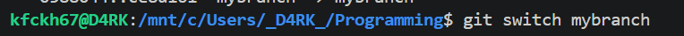

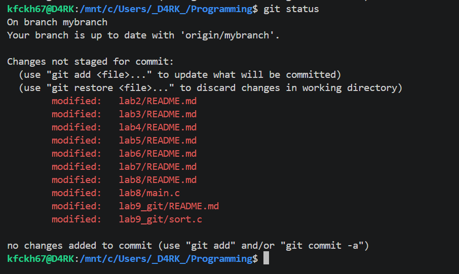

Я на ветке `mybranch`, она синхронизирована с `origin/mybranch`.

## Шаг 2. Добавляем main() в sort.c

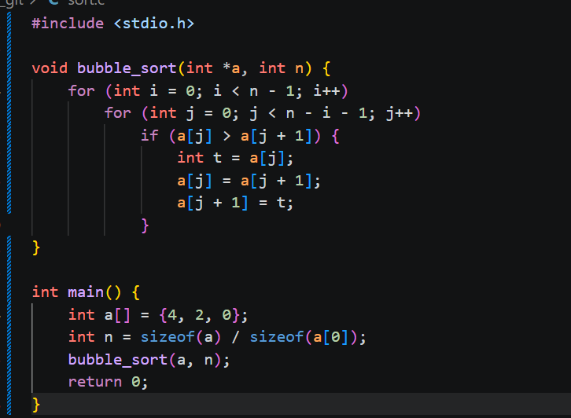

Содержимое `sort.c` заменено: сверху функция сортировки `bubble_sort`, ниже `main()` с массивом `int a[] = {4, 2, 0};` и вызовом сортировки.

## Шаг 3. git diff

```bash
git diff lab9_git/sort.c
```

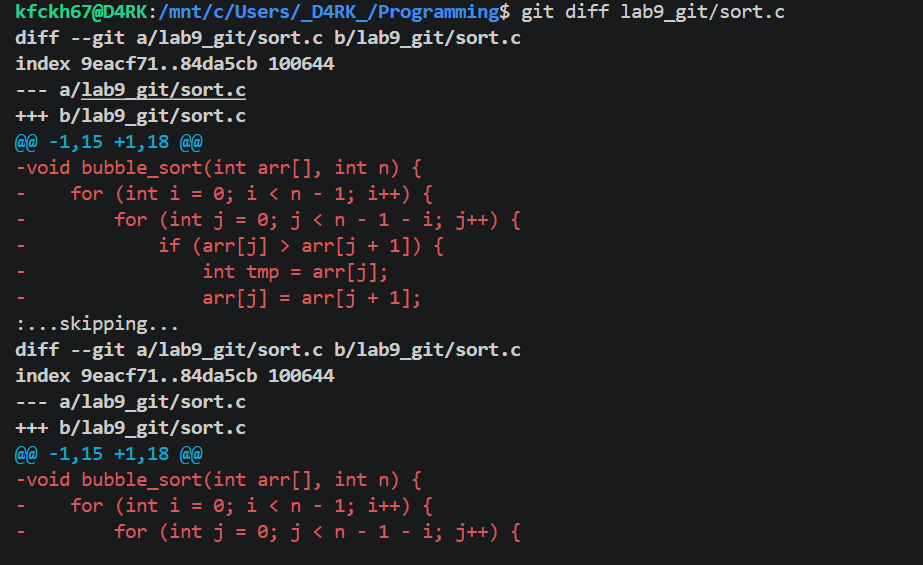

`git diff` сравнивает рабочую папку с индексом. Файл ещё не добавлен в stage, поэтому показаны все правки: старая функция (`-`) заменена новым кодом (`+`). Строки `:...skipping...` появились из-за постраничного просмотра.

## Шаг 4. git diff --staged

```bash
git diff --staged
```

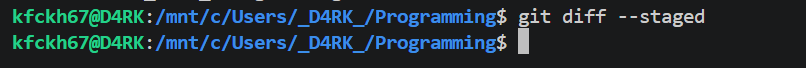

Вывод пустой. `git diff --staged` сравнивает индекс с последним коммитом, а в индексе пока ничего нет.

## Шаг 5. Добавляем sort.c в stage

```bash
git add lab9_git/sort.c
```

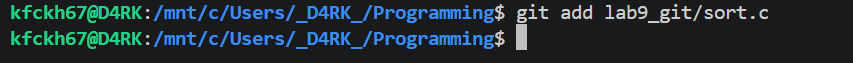

## Шаг 6. git diff после add

```bash
git diff lab9_git/sort.c
```

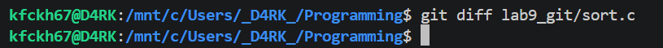

Вывод пустой: рабочая папка совпадает с индексом, сравнивать нечего.

## Шаг 7. git diff --staged после add

```bash
git diff --staged lab9_git/sort.c
```

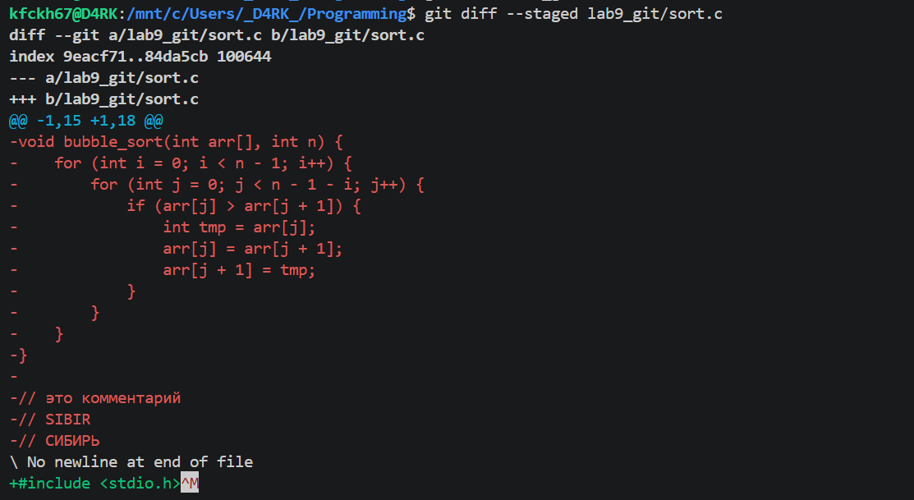

Теперь виден весь diff: это изменения, которые попадут в следующий коммит (индекс против последнего коммита).

## Шаг 8. Удаляем число из массива

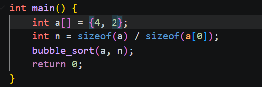

В `main()` массив теперь `int a[] = {4, 2};`, число `0` удалено.

## Шаг 9. git diff

```bash
git diff lab9_git/sort.c
```

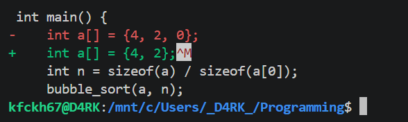

Показана только последняя правка: строка `{4, 2, 0}` (`-`) заменена на `{4, 2}` (`+`). Это разница между рабочей папкой и индексом. (`^M` в конце строки это символ CRLF.)

## Шаг 10. git diff --staged

```bash
git diff --staged lab9_git/sort.c
```

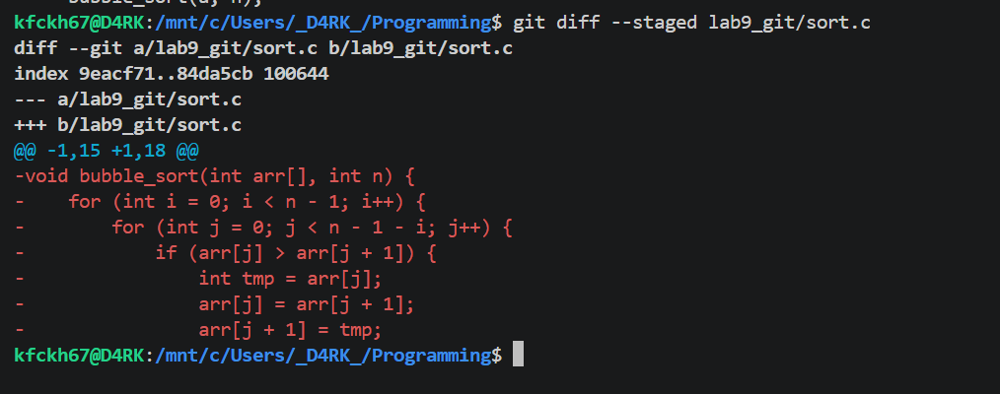

Вывод длинный, как на шаге 7: в индексе лежит версия, добавленная до удаления числа, то есть с массивом `{4, 2, 0}`.

## Шаг 11. Что происходит

У файла `sort.c` теперь две разные версии изменений. В индексе лежит версия с `{4, 2, 0}` (она добавлена командой `git add`). В рабочей папке лежит более новая версия с `{4, 2}`. `git diff` показывает разницу между рабочей папкой и индексом (удаление числа), а `git diff --staged` показывает разницу между индексом и последним коммитом (весь `main()`). Если сейчас сделать коммит, в него попадёт версия из индекса, то есть с `{4, 2, 0}`, а удаление числа останется незакоммиченным.

## Шаг 12. git status: sort.c дважды

```bash
git status
```

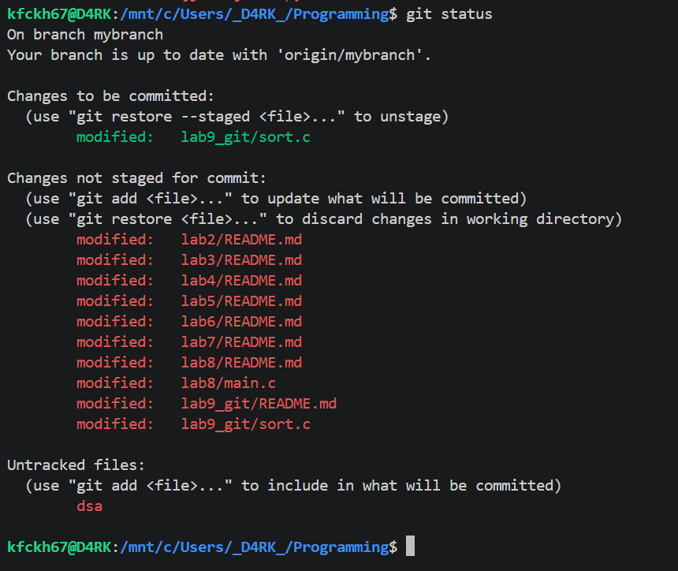

`lab9_git/sort.c` встречается два раза: зелёным в «Changes to be committed» (версия в индексе) и красным в «Changes not staged for commit» (версия в рабочей папке).

## Шаг 13. git restore --staged

```bash
git restore --staged lab9_git/sort.c
```

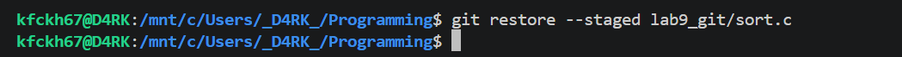

Файл убран из индекса. Правки в самом файле при этом сохранились.

## Шаг 14. git status после restore --staged

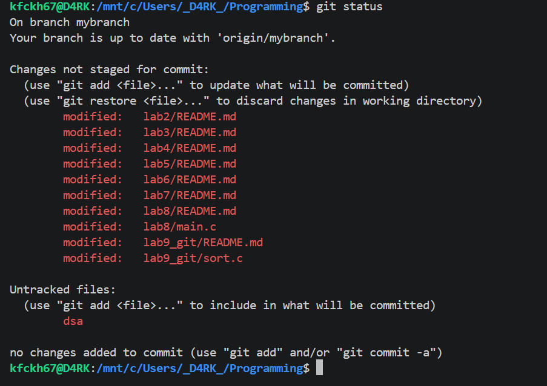

Теперь `sort.c` один раз, только в «Changes not staged for commit». Раздела «Changes to be committed» больше нет.

## Шаг 15. Индексируем и коммитим

```bash
git add lab9_git/sort.c
git commit -m "Add main to sort.c"
```

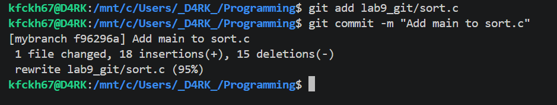

В коммит попала версия с массивом `{4, 2}`. Добавлял я только `sort.c`, а не `git add .`, чтобы в коммит не попали `lab2`-`lab8`.

## Шаг 16. Журнал

```bash
git log --oneline
```

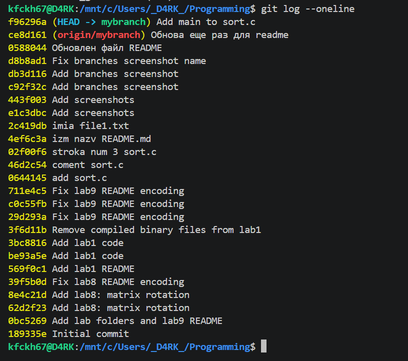

Наверху новый коммит `Add main to sort.c` (`HEAD -> mybranch`). `origin/mybranch` находится на один коммит позади, потому что я ещё не делал push.

## Шаги 17-18. Добавляем printf и смотрим файл

В `main()` перед `return 0;` добавлена строка `printf("hello git\n");`.

```bash
cat lab9_git/sort.c
```

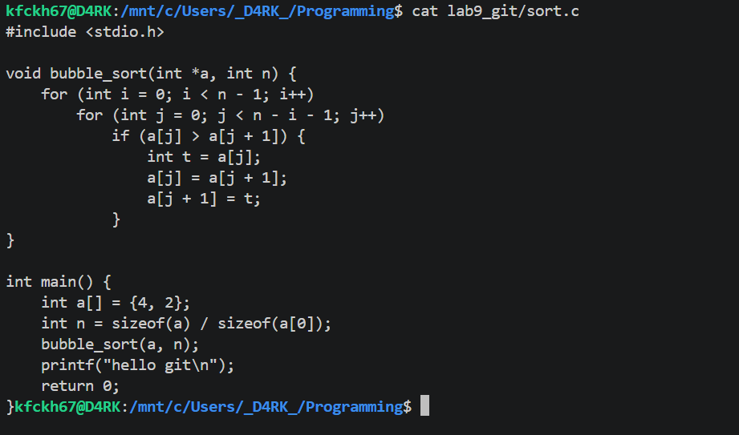

В файле видна строка с `printf`.

## Шаг 19. git status

```bash
git status
```

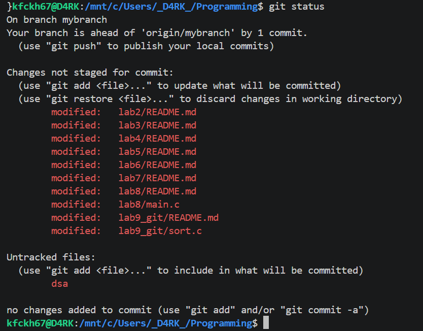

`lab9_git/sort.c` изменён, но не добавлен в stage. Также git пишет, что ветка опережает `origin/mybranch` на 1 коммит.

## Шаги 20-21. git restore и содержимое sort.c

```bash
git restore lab9_git/sort.c
cat lab9_git/sort.c
```

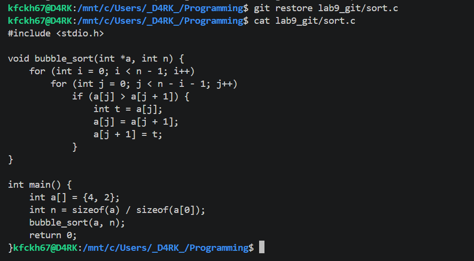

`git restore` откатил файл к состоянию последнего коммита. Строка с `printf` пропала.

## Шаг 22. git status после restore

```bash
git status
```

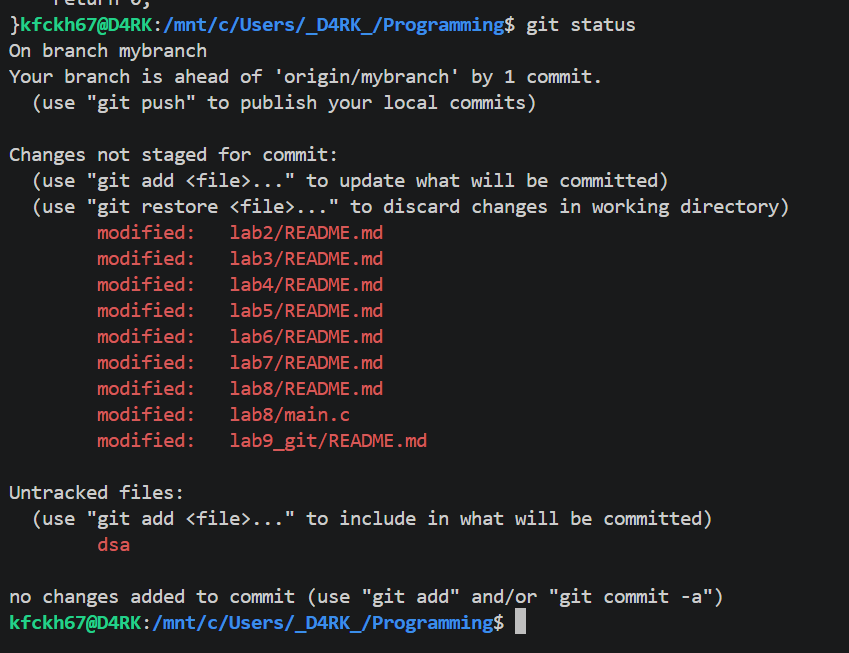

`lab9_git/sort.c` в списке изменённых больше нет. Незакоммиченных правок в нём не осталось.

## Шаг 23. Push ветки

```bash
git push
```

<!-- Вставь сюда скриншот git push и git status после него -->
