# Скриншоты к лабораторной работе 9

Ветка master в этом репозитории называется main.

## Часть 1. Коммиты

### Пункт 1. На какой ветке мы находимся
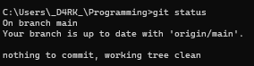

`git status` показывает текущую ветку: main.

### Пункт 2. Журнал коммитов
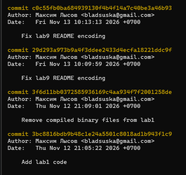

Так выглядит `git log`: список коммитов с хешем, автором, датой и сообщением.

### Пункты 3-4. Создан sort.c, состояние git status
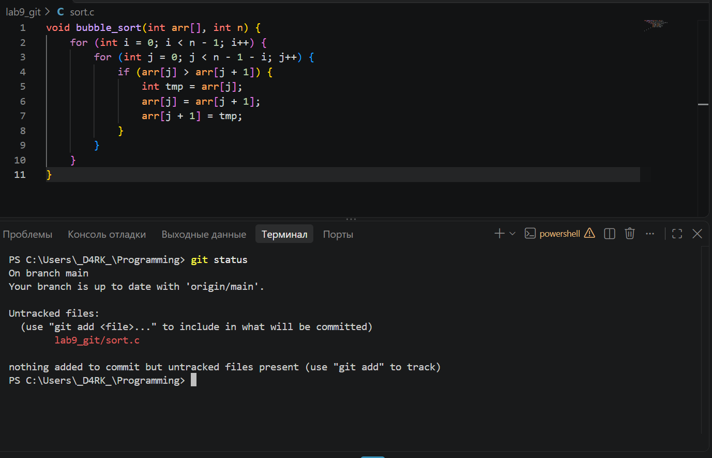

Файл sort.c создан, но Git его ещё не отслеживает (Untracked files).

### Пункты 5-6. Файл добавлен в stage
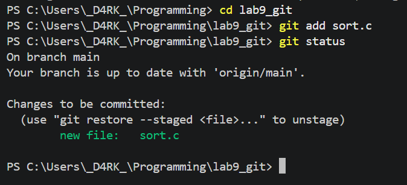

После `git add sort.c` файл попал в Changes to be committed.

### Пункты 7-8. Коммит файла
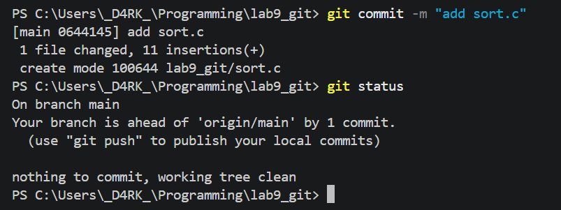

После `git commit` рабочая директория чистая: nothing to commit, working tree clean.

### Пункты 9-10. Добавлен комментарий в файл
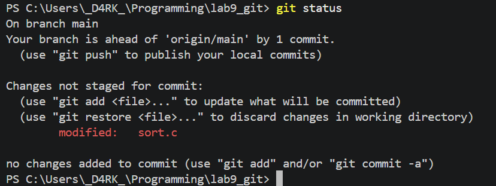

Файл изменён, но не добавлен в stage: Changes not staged for commit, modified: sort.c.

### Пункты 11-12. Изменение добавлено в stage
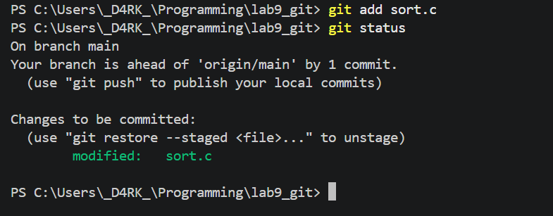

После `git add sort.c` изменение подготовлено к коммиту (Changes to be committed).

### Пункты 13-15. Ещё одно изменение, коммит, статус и журнал
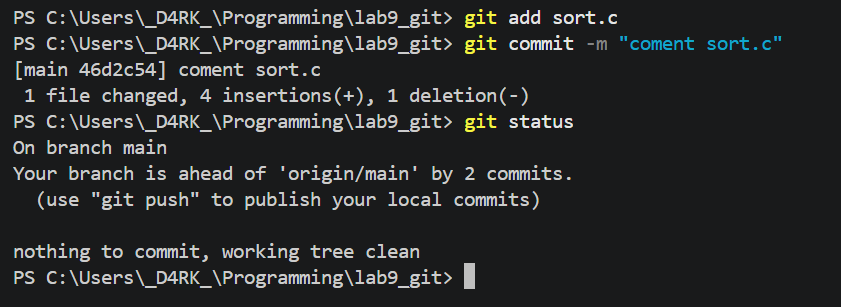

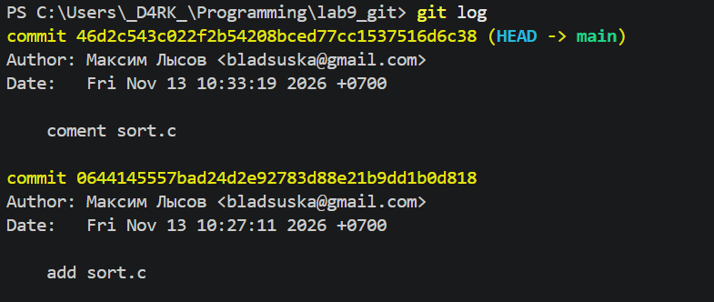

После коммита `git status` показывает новые правки, а в `git log` видны оба коммита по sort.c.

### Пункт 16. Последнее изменение добавлено и закоммичено
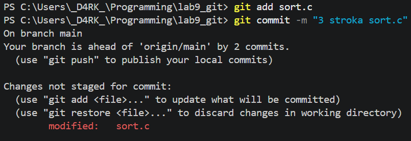

### Пункт 17. Отправка на удалённый репозиторий
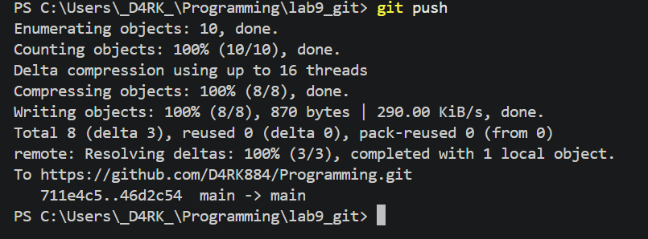

`git push` отправил коммиты на GitHub.

## Часть 2. Ветки

### Пункты 1-2. Создание ветки mybranch
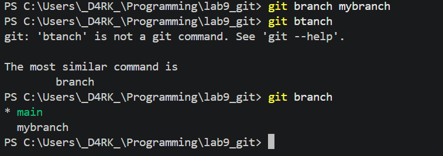

`git branch mybranch` создаёт ветку, `git branch` показывает список, текущая ветка отмечена звёздочкой.

### Пункты 3-4. Переключение на mybranch
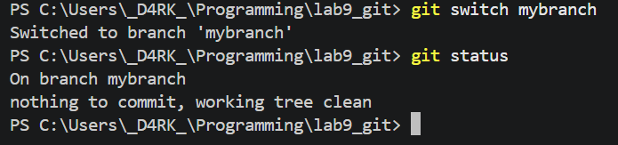

После `git switch mybranch` в `git status` меняется первая строка: On branch mybranch.

### Пункты 4-5. git status на main
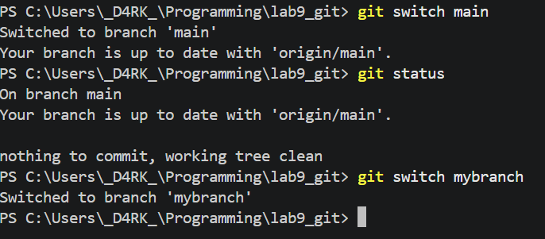

На main первая строка: On branch main. Остальной вывод одинаковый, потому что в mybranch ещё нет новых коммитов. Перед продолжением мы вернулись на mybranch.

### Пункты 6-7. Файл file1.txt и коммит
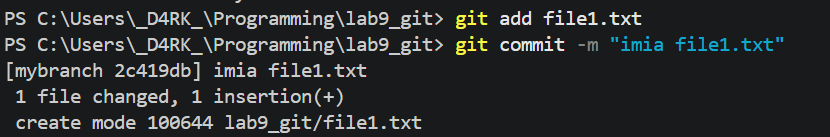

Создан file1.txt с именем, файл добавлен и закоммичен в ветке mybranch.

### Пункт 8. Граф коммитов в mybranch
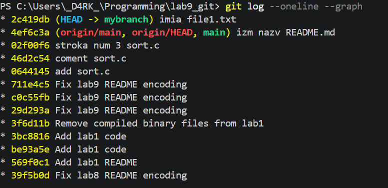

`git log --oneline --graph`: ветка mybranch указывает на новый коммит.

### Пункты 9-10. Возврат на main
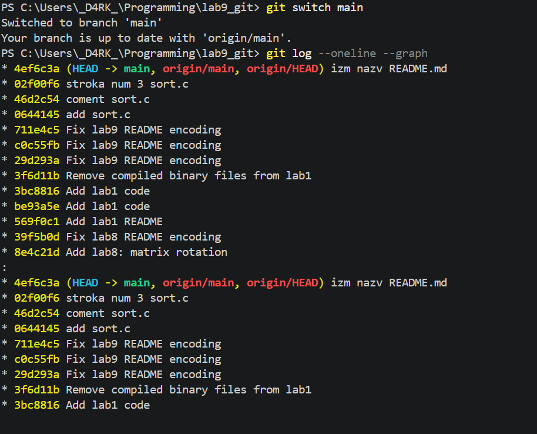

После `git switch main` в журнале нет коммита с file1.txt: он остался только в mybranch.

### Пункт 11. Файл file2.txt в main
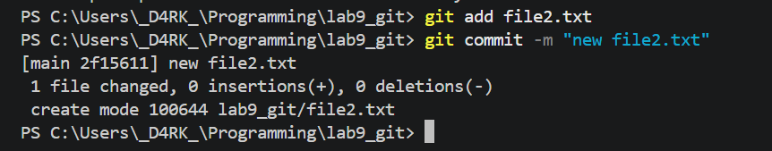

Создан file2.txt и закоммичен в ветке main.

### Пункт 12. Граф всех веток
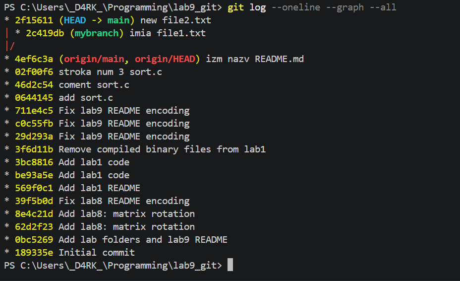

`git log --oneline --graph --all`: у main и mybranch теперь разные коммиты, история разошлась.

### Пункты 13-14. Возврат на mybranch, пропал ли file2.txt
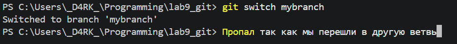

Да, file2.txt пропал: он был закоммичен только в main, поэтому в mybranch его нет.

### Пункт 15. Разница между ветками
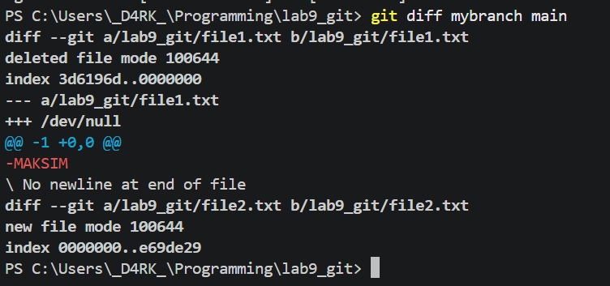

`git diff mybranch main` показывает различия между ветками: file1.txt есть только в mybranch, file2.txt только в main.

### Пункт 17. Две ветки на GitHub
После `git push -u origin mybranch` и `git push` на github.com отображаются обе ветки: main и mybranch.
